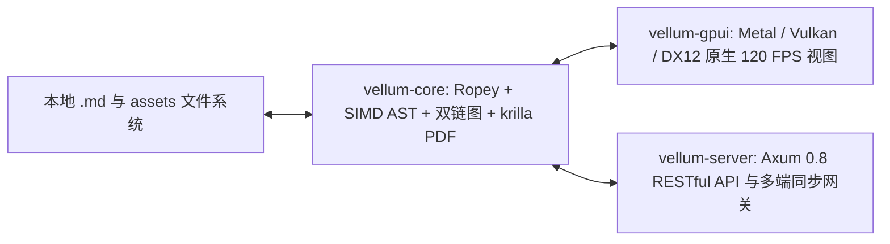

# Vellum Native 核心架构与 Axum RESTful API 技术参考手册

> **工程定位**：基于 `Rust + GPUI + Ropey + Axum` 构建的低内存、120 FPS 原生所见即所得 Markdown 编辑器与双向链接知识网络系统。  
> **关联文档**：[[本地编译与服务端部署完整指南]] · [[Rust + Axum + GPUI 高性能架构白皮书]]

---

## 1. 系统分层架构总览

Vellum Native 严格遵循 **本地优先（Local-First）** 与 **零 WebView 原生渲染** 原则，将核心数据模型、网络持久化服务与 GPU 视图层彻底解耦为三个独立 Crate：



### 1.1 `crates/vellum-core`（零拷贝文档与排版内核）

| 模块路径 | 核心数据结构 | 关键性能与功能职责 |
| :--- | :--- | :--- |
| `src/rope_doc.rs` | `RopeDocument` | 基于 `ropey::Rope` B-Tree 维护全文 UTF-8 缓冲（内存开销仅约文件体积 `1.12x`），支持 64 KiB `BufReader` 流式加载百兆级大文件与零拷贝 `RopeSlice` 无损序列化。 |
| `src/incremental_ast.rs` | `BlockDescriptor` | 基于启用了 `simd` 特性的 `pulldown-cmark` 扫描块级字节区间 `Range<usize>`，不克隆字符串副本，按需解析当前焦点块的局部行内样式。 |
| `src/fenwick_viewport.rs` | `FenwickHeightIndex` | 使用树状数组（Binary Indexed Tree）维护全文档所有块的高度前缀和，任意像素滚动位置反查可见块区间时间复杂度严格为 $\mathcal{O}(\log N)$。 |
| `src/input_rules.rs` | `InputRuleEngine` | 实现 `# ` 标题、`> ` 引用、`- [ ] ` 任务列表、` ``` ` 代码围栏即时转换，并采用两段式撤销栈（首次 `Cmd/Ctrl+Z` 先还原用户键入的原始语法字符）。 |
| `src/knowledge_graph.rs` | `KnowledgeGraphIndex` | 解析 `[[文档#章节\|别名]]` 与 `![[嵌入文档#章节]]` 语法，实时构建正向链接、反向链接（Backlinks）、悬空幻影节点（Phantom Nodes）、潜在未链接提及（Unlinked Mentions）与全库标题重命名无损重写。 |
| `src/kanban.rs` | `KanbanBoardModel` | 自动跳过代码围栏与 YAML 头信息，提取文档中的 GFM 任务复选框并归类为「待办」与「已完成」双栏；拖拽落点通过单字节 `edit_byte_range(offset..offset+1, "x" \| " ")` 直接原地修改 `Rope` 缓冲。 |
| `src/pdf_export.rs` | `FormalPdfOptions` | 基于纯 Rust `krilla` 矢量排版引擎（PDF 1.7 + OpenType/TTC 中文字体自动检索与字形子集化），支持**技术规范白皮书**、**企事业正式公文**、**学术单栏论文**三大版式，含双文头线、受控元信息表、自动多级目录、防孤行保护、三线表/网格表及双遍扫描精确页码。 |
| `src/sync_protocol.rs` | `SyncStateVector` | 预留 Phase 2 基于 `Yrs (Yjs Rust port)` 的块级增量 CRDT 状态向量与实时云备份传输层契约。 |

### 1.2 `crates/vellum-gpui`（纯原生 GPU 加速桌面客户端）

- **`wysiwyg_surface.rs`**：基于 `gpui::uniform_list` / `ListState` 按需挂载视口内约 25～40 个可见块；实现 `gpui::EntityInputHandler` 原生支持 macOS / Linux (Wayland `text-input-v3` / X11 XIM) / Windows 中文拼音 IME 组合态（`marked_text_range` 非空期间锁定自动输入规则，杜绝选词上屏误触发）。
- **`kanban_board.rs`**：100% 原生 GPUI 看板视图，使用 `on_drag`、`drag_over::<DraggedKanbanCard>` 与 `on_drop` 实现 GPU 加速幽灵拖拽卡片与落点高亮，释放鼠标瞬间原地翻转 `RopeDocument` 中的 `[ ]` / `[x]` 并同步回编辑器与本地磁盘。
- **`graph_canvas.rs`**：原生双向链接知识网络图谱画布，支持节点度中心性缩放、悬空节点一键激活创建与点击跳转。
- **`workspace.rs`**：顶层窗口容器，整合侧边栏大纲、即时渲染/源码模式切换、专注模式、打字机模式、一键正式版式矢量 PDF 导出（后台线程池执行，零掉帧）以及后台内嵌 Axum 线程通信。

### 1.3 `crates/vellum-server`（Axum 0.8 高性能 RESTful 服务）

- 基于 `DashMap<String, Arc<RwLock<RopeDocument>>>` 管理并发文档会话；
- 内置 `tower-http` Brotli / Gzip 响应压缩、CORS 策略与 `/assets` 静态资源高效零拷贝分发；
- 所有写操作统一经过 `ServerState::atomic_persist_markdown`（先写 `.{id}.md.tmp` 再原子 `rename`）。

---

## 2. 原生客户端全局快捷键规范

| 功能操作 | macOS 快捷键 | Linux / Windows 快捷键 | GPUI Action 名称 |
| :--- | :--- | :--- | :--- |
| 打开本地 Markdown 文件 | `Cmd + O` | `Ctrl + O` | `OpenLocalMarkdownFile` |
| 原子保存当前文档 | `Cmd + S` | `Ctrl + S` | `SaveCurrentDocument` |
| **导出正式版式矢量 PDF** | `Cmd + Shift + E` | `Ctrl + Shift + E` | `ExportFormalPdf` |
| 切换正式 PDF 版式模板 | `Cmd + Alt + P` | `Ctrl + Alt + P` | `CycleFormalPdfPreset` |
| 切换即时渲染 / 源码模式 | `Cmd + /` | `Ctrl + /` | `ToggleSourceMode` |
| **切换原生任务看板视图** | `Cmd + Shift + K` | `Ctrl + Shift + K` | `ToggleKanbanBoard` |
| **切换双向链接知识图谱** | `Cmd + Shift + G` | `Ctrl + Shift + G` | `ToggleKnowledgeGraph` |
| 展开 / 收起文档大纲侧栏 | `Cmd + \` | `Ctrl + \` | `ToggleOutlineSidebar` |
| 加粗 / 斜体 / 行内代码 | `Cmd + B / I / E` | `Ctrl + B / I / E` | `FormatBold / Italic / InlineCode` |
| 撤销（支持两段式语法还原） | `Cmd + Z` | `Ctrl + Z` | `UndoEdit` |
| 重做修改 | `Cmd + Shift + Z` | `Ctrl + Y` | `RedoEdit` |
| 专注模式 / 打字机模式 | `Ctrl + Shift + F / T` | `Ctrl + Shift + F / T` | `ToggleFocusMode / TypewriterMode` |

---

## 3. Axum RESTful API 完整接口契约（`/api/v1`）

默认本地监听地址：`http://127.0.0.1:4120/api/v1`。

### 3.1 健康检查与同步状态
- **`GET /api/v1/health`**
  - 返回示例：
    ```json
    {
      "status": "ok",
      "engine": "vellum-core (ropey + pulldown-cmark simd)",
      "framework": "axum 0.8"
    }
    ```
- **`GET /api/v1/sync/status`**
  - 返回本地优先持久化模式与 Phase 2 CRDT 同步协议预留状态。

### 3.2 文档管理与视口分片读取
- **`GET /api/v1/documents`**：列出工作区全部文档元数据、修订号 `revision` 与 `DocumentMetrics`（字节数、字数、块数、预计阅读分钟数、Rope 估算内存占用、`BLAKE3` 校验和）。
- **`POST /api/v1/documents`**：创建新文档并原子落盘。
  - 请求体：`{ "title": "架构设计笔记", "content": "# 架构设计笔记\n\n正文..." }`
- **`GET /api/v1/documents/{id}?offset=0&limit=120&include_raw=true`**：分页获取指定块窗口 `block_window`、文档大纲 `outline` 与完整无损 Markdown。
- **`PUT /api/v1/documents/{id}`**：全量无损保存文档并自动更新知识图谱双链索引。
- **`PATCH /api/v1/documents/{id}/rope-delta`**：**字节区间增量补丁接口**（避免超大文档全量重传）。
  - 请求体：
    ```json
    {
      "start_byte": 128,
      "end_byte": 128,
      "inserted": "新增段落内容\n",
      "allow_input_rules": false
    }
    ```
- **`DELETE /api/v1/documents/{id}`**：删除指定文档并从 `KnowledgeGraphIndex` 移除关联边。

### 3.3 全文 / 正则流式检索与本地历史快照
- **`POST /api/v1/documents/{id}/search`**
  - 请求体：`{ "query": "RopeSlice", "case_sensitive": false, "whole_word": false, "use_regex": false }`
  - 返回匹配块索引 `block_index`、精确 UTF-8 字节区间 `byte_range` 与上下文预览行。
- **`GET /api/v1/documents/{id}/snapshots`** & **`POST /api/v1/documents/{id}/snapshots`**：列出或创建当前修订版本的内存/本地历史快照。

### 3.4 双向链接知识网络与全库重命名重构
- **`GET /api/v1/graph`**：获取全工作区知识图谱快照 `KnowledgeGraphSnapshot`（节点含解析状态、入度/出度、字数；边区分 `wiki_link` 与 `embed_transclusion`）。
- **`GET /api/v1/documents/{id}/links`**：查询指定文档的所有正向引用 `outgoing` 与反向链接上下文 `backlinks`。
- **`POST /api/v1/documents/{id}/refactor-title`**：重命名文档标题，并自动扫描全工作区所有引用了旧标题的 `[[旧标题#章节|别名]]` 与 `![[旧标题]]`，无损重写为新标题并原子落盘。
  - 请求体：`{ "new_title": "Ropey 零拷贝 B-Tree 内核" }`

### 3.5 原生任务看板状态同步
- **`GET /api/v1/documents/{id}/kanban`**：解析并返回该文档的 `todo`（待办）与 `done`（已完成）任务卡片列表（含所属章节标题与 `[ ]` 状态字符精确字节偏移 `state_byte_offset`）。
- **`PATCH /api/v1/documents/{id}/kanban`**：单字节修改任务完成状态并原子落盘。
  - 请求体：`{ "state_byte_offset": 412, "completed": true }`

### 3.6 正式版式矢量 PDF 导出与本地图片资源上传
- **`POST /api/v1/documents/{id}/export-pdf`**
  - 请求体（可选，省略时使用默认技术白皮书 A4 配置）：
    ```json
    {
      "preset": "technical_spec",
      "paper_size": "a4",
      "margin_mm": 25.4,
      "include_cover_meta": true,
      "include_toc": true,
      "auto_number_headings": true,
      "include_header_footer": true,
      "document_code": "VN-SPEC-2026-01",
      "organization": "Vellum Native Architecture Group"
    }
    ```
    （其中 `preset` 支持 `"technical_spec"` | `"official_report"` | `"academic_paper"`；`paper_size` 支持 `"a4"` | `"letter"`）
  - 响应：`200 OK`，`Content-Type: application/pdf`，返回子集化内嵌中文字体的标准 PDF 1.7 二进制流。
- **`POST /api/v1/assets`**：`multipart/form-data` 上传图片，服务端计算 `BLAKE3` 前 16 位哈希命名存入 `assets/`，返回相对引用语法 ``。
